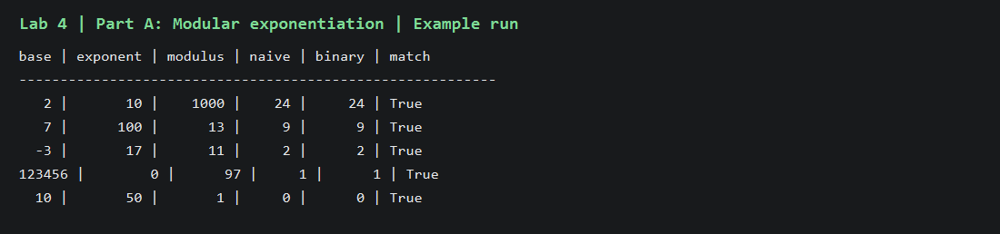
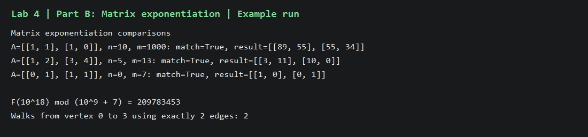

# Lab 4: Modular and Matrix Exponentiation

## Lab report

### Objective and method

This lab compared repeated multiplication with square-and-multiply for modular
exponentiation, then applied the same approaches to modular matrix powers.
Input checks cover negative exponents, invalid moduli, negative bases, and
matrix dimensions. Matrix exponentiation was also used to compute Fibonacci
numbers and exact-length directed-graph walk counts.

### Results

Both implementations agreed in the comparison examples and all 45 matrix
benchmark combinations. In one observed run, modular exponentiation at
`b = 1,000,000` took about **0.184 s** naively and **0.000021 s** with binary
exponentiation. For a 32 x 32 matrix raised to `n = 4096`, the corresponding
times were about **55.216 s** and **0.214 s**. Timings vary by machine and run.
The Fibonacci calculation returned
`F(10^18) mod (10^9 + 7) = 209783453`, without generating preceding terms.
All five unit tests passed.

### Conclusion

Binary exponentiation reduces the number of multiplication steps from linear
to logarithmic in the exponent, producing a substantial speedup while
preserving the result. The tests and comparisons also verified the edge cases
and the matrix applications.

## Screenshots

### Part A - Modular exponentiation



### Part B - Matrix exponentiation, Fibonacci, and graph walks



## Part A: Modular exponentiation

`Lab4_Q1_ModularExponentiation.py` implements repeated-multiplication and
square-and-multiply modular exponentiation. Both implementations validate
inputs, accept negative bases by reducing them modulo `m`, and return `1 mod m`
for exponent zero. Run the examples with:

```powershell
python Lab4_Q1_ModularExponentiation.py
```

Run the benchmark at exponents 10, 100, ..., 1,000,000 with:

```powershell
python Lab4_Q1_ModularExponentiation.py --benchmark
```

## Part B: Matrix modular exponentiation

`Lab4_Q2_MatrixExponentiation.py` provides modular matrix multiplication,
identity-matrix generation, naive and binary matrix exponentiation, Fibonacci
numbers modulo `m`, and exact-length directed-graph walk counts. The examples
also calculate `F(10^18) mod (10^9 + 7)` without enumerating earlier terms.
Run them with:

```powershell
python Lab4_Q2_MatrixExponentiation.py
```

Run all 45 combinations of dimensions 2, 4, 8, 16, 32 and exponents
`2^4, 2^5, ..., 2^12` with:

```powershell
python Lab4_Q2_MatrixExponentiation.py --benchmark
```

The naive matrix benchmark is intentionally computationally expensive. Each
benchmark reports elapsed wall-clock time and checks that the two algorithms
produce the same result.

## Tests

Run the standard-library tests from this directory:

```powershell
python -m unittest -v test_lab4.py
```
